# tp-final-distribuidos

## Diseño inicial

En una idea inicial, podemos presentar 2 casos de entrada posibles: 

1- Un único gateway de entrada al sistema a través del cual todos los clientes realizan sus pedidos, este gateway distibuye cargas a partir de este gateway en diferentes nodos que comenzaran a realizar diferentes pedidos. 

2- Varios gateways, cada uno conectado a diferentes nodos luego, para que no se mezclen informaciones correspondientes a diferentes clientes. Esto podría solucionarse (igual a trabajos previos) con un id asociado a cada cliente, y compartir instancias de diferentes actividades. 

### Caso 1 de entrada al sistema

#### Ventajas

Con un único gateway vamos a tener simplicidad a la hora de manejar a los clientes. Toda la información del sistema ingresa por un único punto de entrada, por lo que es fácil de comprender y seguir el flujo del request de un cliente en su comienzo. 

A su vez, no hay que coordinar entre gateways o instancias porque toda la información volvería al mismo gateway para enviar al cliente el resultado de su request.

#### Desventajas

Principalmente, la simplicidad nos trae como problema un Unico Punto de Falla (SPOF). Esto no nos generaría un sistema un poco frágil en busqueda de ganar simplicidad, y lo haría poco escalable a su vez. 

### Caso 2 de entrada al sistema 

#### Ventajas

Un sistema que escala mejor ante mayor cantidad de requests de clientes, la distribución de cargas puede soportarse mejor, y ante fallas en un gateway, otro puede tomar temporalmente los requests del caído hasta que vuelva (a debatir).

#### Desventajas

El sistema va a tener mayor complejidad en el manejo de información. 

#### Posible solución

Podemos intentar manejar unicamente información en este gateway (de entrada y de salida) y entonces no tendríamos problemas a la hora de saber a quien envíar información o si esta se encuentra completa o no. El gateway recibe un mensaje a enviar a un cliente con información y simplemente la envía. Al ser stateless, podemos escalar con mayor cantidad de instancias de esta entidad Gateway de ser necesario sin presentarnos problemas.

### Decisión final

Usamos un único gateway con estado. Todos los clientes se conectan a él, y mantiene la conexión TCP y el estado de las cinco consultas de cada cliente.
Así conservamos las ventajas del caso 1: la entrada y la salida pasan por un solo punto y no hay que coordinar entre gateways. A cambio, aceptamos su desventaja: el gateway es un único punto de falla.

# Diagrama: Punto de entrada y salida del sistema

Aca se muestra una primera idea de como se vería el sistema de entrada del sistema. Si bien se muestran 2 clientes A y B, esto obviamente escalaría a N clientes que deseen utilizar el sistema.

## Ida: recibir los datos de un cliente

En la implementación actual, todos los clientes se conectan por TCP al mismo gateway, usando `SERVER_HOST` y `SERVER_PORT`. El gateway mantiene la conexión y el estado de cada cliente, agrega `client_id` y `gateway_id` a los batches y los publica en la cola compartida `clasificacion`. Cuando recibe `END_OF_DATA`, publica un EOF y conserva la conexión para devolver los resultados.

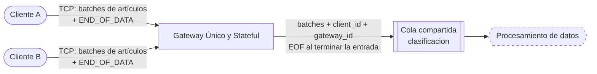

## Vuelta: enviar resultados a medida que van llegando

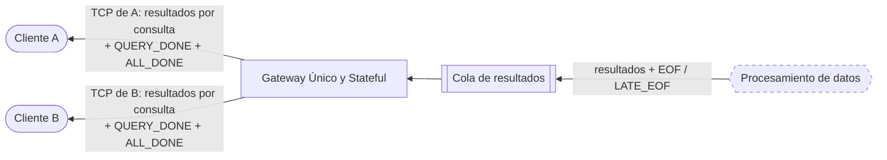

Los nodos de procesamiento publican resultados y avisos de fin en la cola `resultados.<gateway_id>`. El gateway consume esa cola, identifica al cliente por `client_id` y envía cada resultado por la misma conexión TCP usada para la entrada. Mantiene el estado de las cinco consultas por cliente: envía `QUERY_DONE` cuando termina una consulta y `ALL_DONE` cuando terminó la entrada y se completaron las cinco. Luego cierra la conexión TCP.
Los flujos de procesamiento de cada consulta se describen en la sección siguiente.

# Requisitos Funcionales

El cliente establece una conexion con el servicio y empieza a leer el archivo por batches. El archivo es Parquet y no entra entero en memoria, así que lo lee de a partes. Cada batch tiene un conjunto de artículos enteros, y de cada artículo lleva solo las 8 columnas que usan las consultas: `name`, `url`, `in_language`, `date_created`, `date_modified`, `abstract`, `sections` e `image.content_url`. El cliente va agregando artículos al batch hasta llegar a un tope de N artículos o X KB, lo que pase primero. Un artículo nunca se parte entre dos batches: si no entra, se cierra el batch y el artículo empieza el siguiente. Si un artículo solo ya pesa más que X, va solo en su batch (ver "Tamaño de los artículos"). 
La lectura del archivo y la formación de los batches de entrada son responsabilidad del cliente.

El sistema tiene que responder las 5 consultas a la vez sobre el mismo archivo. El gateway reenvía cada batch que recibe a los clasificadores, que lo reparten entre las 5 consultas (ver "Filtrado de entrada"), y cada flujo procesa los datos en paralelo. Cada resultado indica a qué consulta corresponde, y el cliente los va recibiendo a medida que cada consulta termina.

Se detectan las siguientes entidades de cómputo. Cada una se describe en detalle en las secciones siguientes:

| Entidad | Estado | Qué hace |
|---|---|---|
| Gateway | con estado | Mantiene la conexión y el estado de las cinco consultas de cada cliente, publica los batches en la cola de los clasificadores y le devuelve los resultados. |
| Clasificador | sin estado | Decide el período y el idioma de cada artículo, recorta las columnas y lo reparte entre las consultas. Resuelve Q1. |
| Filter biography | sin estado | Deja pasar los artículos que mencionan "biography" o "biographie" (Q2). |
| Buscador de imágenes | sin estado | Baja la imagen de cada artículo de Q2. |
| Text processor | sin estado | Saca las palabras únicas de cada abstract, sin stopwords, y las cuenta (Q3, Q4 y Q5). |
| Contador de palabras | con estado | Junta, por palabra, en cuántos artículos aparece y en qué idiomas (Q3 y Q4). |
| Join Q3 | con estado | Junta las palabras compartidas de todos los contadores (Q3). |
| Top 20 final | con estado | Junta los tops locales y elige el top 20 (Q4). |
| Promedio | con estado | Calcula el promedio de palabras de los artículos hasta 2020 (Q5). |
| Comparador | con estado | Se queda con los artículos desde 2021 que superan el promedio (Q5). |

## Responsabilidad de leer el archivo y armar los batches

### Opción 1: la responsabilidad es del cliente

Es lo que se describe al principio de esta sección. El cliente lee el archivo, agrupa las filas crudas en batches y se los manda al gateway. El gateway solo reenvía esos batches a los clasificadores.

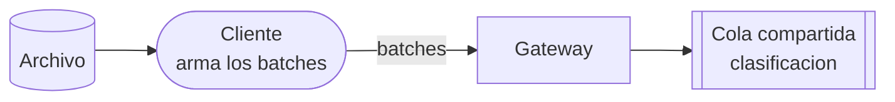

#### Ventajas

* El sistema es más simple: recibe los datos ya agrupados y no necesita saber nada del archivo.
* La lectura se reparte sola, porque cada cliente lee su propio archivo.

#### Desventajas

* El ritmo de entrada depende del cliente. Si lee lento, el sistema queda esperando.
* Cada cliente tiene que respetar el formato y el tamaño de batch que define el protocolo.

### Opción 2: la responsabilidad está dentro del sistema

El cliente solo se conecta al gateway y pide que se procese el dataset. La lectura la hacen varios searchers dentro del sistema: cada uno obtiene una parte de los artículos con la librería del dataset de Kaggle, la deja en un batch y lo manda a los clasificadores. Los datos no pasan por el cliente ni por el gateway.

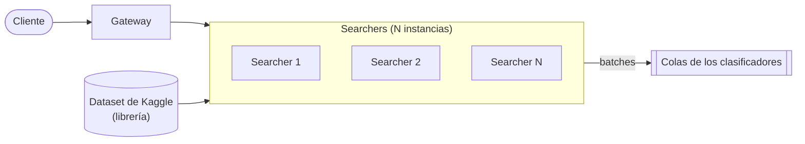

#### Ventajas

* El cliente es más liviano: no lee el archivo ni arma batches.
* Los artículos no viajan del cliente al sistema, porque los searchers los obtienen directo de la librería.
* El sistema controla el tamaño de los batches y el ritmo de lectura.
* La lectura escala agregando searchers.

#### Desventajas

* El sistema depende de la librería y del servicio externo para obtener los datos. Además, el enunciado pide que el cuerpo docente apruebe el uso de cualquier biblioteca.
* Hay que coordinar a los searchers para que no lean dos veces la misma parte, y para saber cuándo terminaron todos y cerrar las consultas.

# Filtrado de entrada

## Dataset

Usamos el dataset [Wikipedia Structured Contents](https://www.kaggle.com/datasets/wikimedia-foundation/wikipedia-structured-contents) de Kaggle:

* Tiene solo artículos en inglés (7.597.149) y en francés (2.871.732). Todo artículo es de uno de los dos idiomas, y el idioma se lee de `in_language.identifier`.
* Viene en Parquet, partido en 112 shards, y pesa 44,42 GiB en total.
* Las consultas solo usan 8 columnas: `name`, `url`, `in_language`, `date_created`, `date_modified`, `abstract`, `sections` e `image.content_url`. Las más pesadas (`tables`, `references`, `infoboxes`) no las usa ninguna.

### Tamaño de los artículos

Medimos cuánto pesa cada artículo para saber si alguno puede no entrar en un mensaje. RabbitMQ 4.x acepta por defecto mensajes de hasta 16 MiB.

Wikimedia publica el mismo dataset en [Hugging Face](https://huggingface.co/datasets/wikimedia/structured-wikipedia), con estadísticas por columna. Esas estadísticas salen de una muestra de unos 554.000 artículos por idioma, y estos son los largos en bytes:

| Columna | Inglés: media | Inglés: máximo | Francés: media | Francés: máximo |
|---|---|---|---|---|
| `abstract` | 371 | 32.683 | 276 | 20.328 |
| `sections` | 4.122 | 845.564 | 4.852 | 1.048.777 |
| `name` | 20 | 167 | 19 | 188 |
| `url` | 51 | 197 | 51 | 266 |

Como la muestra no incluye todo el dataset, también medimos los artículos más largos de cada Wikipedia, según la página "Longpages" de cada una. Tienen como máximo 900 KB de wikitext, y su HTML completo pesa como máximo 5 MB. El HTML es una cota superior, porque `sections` se arma a partir del HTML y pesa mucho menos.

Conclusiones:

* Ningún artículo debería acercarse a los 16 MiB. El peor caso está en el orden de 1 a 5 MB, así que no hace falta partir artículos.
* Un artículo promedio, con las 8 columnas, pesa unos 5 KB, y casi todo es `sections`. Por ejemplo, un batch de 1 MB lleva unos 200 artículos.
* Con las 8 columnas sin comprimir, entran al sistema unos 50 GB en total, casi lo mismo que pesa el dataset completo comprimido.

### Fechas

El enunciado filtra por artículos "escritos" hasta 2020, y el dataset tiene dos fechas: `date_created` y `date_modified`. Contamos las dos sobre el dataset completo:

| | Inglés | Francés | Total |
|---|---|---|---|
| Artículos | 7.597.149 | 2.871.732 | 10.468.881 |
| `date_created` con valor | 6.154.901 (81 %) | 1.768.141 (62 %) | 7.923.042 (76 %) |
| `date_created` vacío | 1.442.248 (19 %) | 1.103.591 (38 %) | 2.545.839 (24 %) |
| Hasta 2020 según `date_modified` | 140.724 (1,9 %) | 176.112 (6,1 %) | 316.836 (3 %) |
| Hasta 2020 según `date_created` | 5.109.778 (67 %) | 1.387.372 (48 %) | 6.497.150 (62 %) |

* "Escrito" corresponde a la fecha de creación. En cambio, lo que Q1 devuelve junto con la url es la fecha de modificación, `date_modified`.
* Con `date_modified`, un artículo escrito en 2005 y editado el mes pasado cuenta como de 2026.

**Regla para decidir el período de un artículo:**

1. El período sale solo de `date_created`.
2. Si `date_created` está vacío, el artículo no tiene período y se ignora en las consultas que filtran por fecha (Q1, Q2 y Q5). Sigue contando para Q3 y Q4, que no miran la fecha.

Con esta regla, los artículos quedan así:

| | Inglés | Francés | Total |
|---|---|---|---|
| Hasta 2020 | 5.109.778 (67 %) | 1.387.372 (48 %) | 6.497.150 (62 %) |
| Desde 2021 | 1.045.123 (14 %) | 380.769 (13 %) | 1.425.892 (14 %) |
| Sin período | 1.442.248 (19 %) | 1.103.591 (38 %) | 2.545.839 (24 %) |

**Datos vacíos.** La misma idea vale para el resto de las columnas: si a un artículo le falta un dato que una consulta necesita, esa consulta lo ignora. El clasificador no lo manda a donde no sirve:

* a `texto`, solo si tiene `abstract`;
* a `bio`, solo si tiene `sections` e `image_url`, porque Q2 devuelve la imagen;
* a Q1, solo si tiene `date_modified`, porque es lo que devuelve.

## Del gateway a las colas de procesamiento

1. **Lectura.** El cliente lee el archivo y arma los batches con las ocho columnas requeridas por el protocolo, incluida `in_language`.
2. **Gateway.** Conserva las columnas requeridas, agrega `client_id` y `gateway_id` y publica el batch en la cola compartida `clasificacion`. Todos los mensajes internos llevan esos dos identificadores.
3. **Clasificador (N instancias).** Todas las instancias consumen de `clasificacion`. Para cada artículo calculan el período a partir de `date_created` y leen el idioma de `in_language.identifier`.
4. **Colas de procesamiento.** El clasificador agrupa las filas por destino y publica un batch con las columnas que necesita cada etapa:

    | Destino | Columnas | Se publica para | Consumidores |
    |---|---|---|---|
    | `bio` | name, url, sections, image_url | hasta 2020, con sections e image_url | Instancias de Filter biography (Q2), que comparten la cola |
    | `texto` | url, abstract, período, idioma | todos los que tienen abstract | Instancias de Text processor (Q3, Q4 y Q5), que comparten la cola |

    Cada mensaje contiene filas para un solo destino. Un artículo puede participar en varias consultas: por ejemplo, una biografía con abstract puede generar filas para `bio` y `texto`.

    Para Q1, el clasificador publica las filas de url y `date_modified` de los artículos en inglés creados hasta 2020 y con fecha de modificación en la cola de resultados del gateway del cliente.

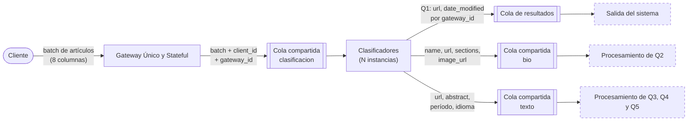

Los nodos punteados agrupan partes del sistema que se explican en otra sección.

Toda la comunicación entre etapas pasa por RabbitMQ. Los productores publican los datos en colas durables mediante el exchange por defecto. La distribución depende de la etapa:

* **Colas compartidas:** `clasificacion`, `bio`, `texto` e `imagenes` tienen varios consumidores. RabbitMQ distribuye cada mensaje entre las instancias que comparten la cola.
* **Colas por instancia:** el productor elige el destino por hash o por round-robin, según la consulta. Por ejemplo, cada palabra va a `palabras.<i>` según su hash, y los batches de candidatos de Q5 se reparten entre `comparacion.<i>`.
* **Avisos a todas las instancias:** los clasificadores, filtros de biografías, descargadores y procesadores de texto usan exchanges direct de control para compartir EOF y LATE_EOF entre las réplicas de su etapa. Average envía una copia del promedio final a cada cola durable de los comparadores.

# Procesamiento de las consultas

## Q1

1. Todas las instancias del clasificador consumen de la cola compartida `clasificacion`. Para los artículos en inglés creados hasta 2020 y con `date_modified`, el clasificador arma una fila con url y fecha de modificación.
2. Publica esas filas como resultados de Q1 (`query=1`) en la cola de resultados del gateway del cliente, elegido por `gateway_id`.

Los resultados de Q1 salen a medida que se clasifican los batches. El clasificador también publica las filas de las otras consultas en las colas compartidas `bio` y `texto`.

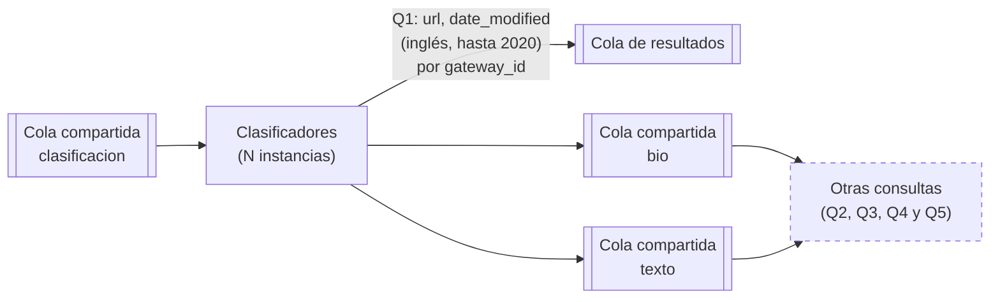

## Q2

A la cola compartida `bio` llegan artículos creados hasta 2020, con name, url, sections e image_url. Q2 se resuelve en dos etapas que escalan por separado: el filtro de biografías y la descarga de imágenes.

**Filter biography (N instancias)**

1. Todas las instancias consumen de la misma cola `bio`.
2. Busca "biography" o "biographie" en el string completo de `sections`, sin distinguir mayúsculas y usando ambas palabras para todos los artículos. La búsqueda incluye títulos, texto y enlaces, y se hace directamente sobre el string.
3. Para cada coincidencia publica name, url e image_url en la cola compartida `imagenes`, conservando `client_id` y `gateway_id`. Agrupa los pedidos con límites de filas y bytes, incluido el mensaje JSON completo.

**Buscador de imágenes (N instancias)**

1. Todas las instancias consumen de la misma cola `imagenes`. Cada instancia procesa un batch por vez y mantiene una sola descarga activa en un hilo aparte; el hilo consumidor sigue atendiendo RabbitMQ y publica los resultados.
2. Primero consulta la caché persistente de imágenes, compartida por las réplicas. Si encuentra la URL, usa los bytes guardados. Cuando falta una imagen, la descarga desde `image_url` y guarda la descarga exitosa en la caché. La caché se puede desactivar por configuración.
3. Las solicitudes HTTP usan un User-Agent que identifica al sistema. Los timeouts, errores de conexión, HTTP 429 y 5xx se reintentan con espera exponencial y respetando `Retry-After`, hasta obtener la imagen o recibir SIGTERM.
4. Cada imagen obtenida genera un resultado de Q2 con name, url y los bytes originales, representados como una lista de enteros de 0 a 255. Lo publica en la cola de resultados del gateway del cliente, elegido por `gateway_id`.
5. Las URL inválidas, otros errores HTTP, las respuestas vacías o que no son imágenes y los resultados que superan el límite de bytes se descartan.

Los resultados de Q2 salen a medida que se procesa cada imagen. Una misma imagen en caché se reutiliza entre artículos; cada resultado conserva el nombre y la URL del artículo correspondiente.

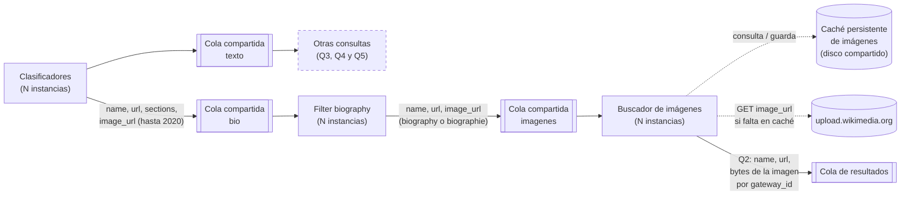

## Del texto a las colas de Q3, Q4 y Q5

Q3, Q4 y Q5 comparten el Text processor. Extrae y limpia las palabras de cada abstract una sola vez y entrega los textos procesados a dos salidas: `WordsOutput` para Q3 y Q4, y `Q5Output` para Q5.

**Text processor (N instancias)**

1. Todas las instancias consumen de la cola compartida `texto`. Cada fila contiene url, abstract, período e idioma.
2. Pasa cada abstract a minúsculas y separa las palabras con `\b\w+\b`, que también corta los apóstrofos del francés.
3. Elimina los números y las stopwords de la unión de las listas de NLTK en inglés y francés, aplicada a todos los textos. La lista procesada conserva las palabras repetidas; cada salida obtiene las palabras distintas con `set`.
4. `WordsOutput` cuenta una aparición por palabra y por artículo. Agrupa todo el batch en entradas `palabra → (cantidad de artículos, aparece en inglés, aparece en francés)` y las reparte por hash de la palabra entre los contadores de Q3 y Q4.
5. `Q5Output` calcula la cantidad de palabras distintas de cada abstract. Para los artículos hasta 2020 acumula la suma de esos conteos y la cantidad de artículos; para los artículos desde 2021 genera candidatos con url y conteo. Los períodos desconocidos se ignoran en Q5. Un abstract histórico vacío aporta cero palabras y un artículo al denominador.
6. Publica los mensajes directamente en las colas de salida, conservando `client_id` y `gateway_id`:

    | Cola | Contenido | Cómo se reparte | Consumidor |
    |---|---|---|---|
    | `palabras.<i>` | palabra, cantidad de artículos y marcas de idioma | por hash de la palabra | Contador de palabras i (Q3 y Q4) |
    | `promedio.<k>` | suma de palabras distintas y cantidad de artículos hasta 2020 | por hash del cliente | Average k (Q5) |
    | `comparacion.<i>` | batches de url y cantidad de palabras distintas de los artículos desde 2021 | round-robin por batch | Comparator i (Q5) |

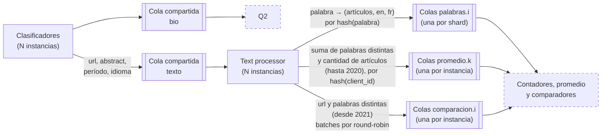

## De las colas de procesamiento a los joins

El Text processor publica directamente en las colas de cada etapa. Cada destino recibe los mensajes según la distribución que necesita:

* **`palabras.<i>` → Contador de palabras (por hash de la palabra).** Cada instancia tiene su propia cola y recibe las palabras de su shard. Todas las apariciones de una palabra llegan al mismo contador.
* **`promedio.<k>` → Promedio (por hash del cliente).** Las estadísticas históricas de un cliente llegan a una sola instancia de Average.
* **`comparacion.<i>` → Comparador (round-robin por batch).** Los batches de candidatos desde 2021 se distribuyen entre las instancias del Comparador.

**Contador de palabras (con estado, N shards)**

Guarda las filas en varios archivos por cliente, repartidos por hash de la palabra en particiones, y hace ack después de escribirlas. Cada palabra queda en una única partición de su shard. Cuando llegan todos los EOF de los Text processor y se cumplen los conteos de procesamiento y recepción, procesa las particiones de a uno. Para cada palabra suma la cantidad de artículos y combina las marcas de inglés y francés. Mantiene en memoria los conteos de una partición y el top local. Después:

* **Para Q3:** publica en batches las palabras que aparecen en ambos idiomas y luego su EOF en `join_q3.<j>`, elegido por hash del cliente.
* **Para Q4:** publica su top local (`TOP_SIZE`, 20 por defecto), con desempate alfabético, y luego su EOF en `top20.<t>`, también elegido por hash del cliente.

Cada salida recibe su EOF incluso cuando no hubo filas para publicar. Al completar los envíos, el contador borra los archivos del cliente y libera su estado.

**Join Q3 (con estado, repartido por cliente)**

Guarda las palabras recibidas en un archivo por cliente. Los EOF y los conteos de recepción se registran en memoria mediante `UpstreamTracker`. Cuando tiene el EOF de todos los contadores y recibió los mensajes anunciados, publica las palabras como resultados de Q3 y borra el archivo.

**Promedio (con estado, repartido por cliente)**

Acumula la suma de palabras distintas y la cantidad de artículos históricos de cada cliente. Cuando se completa la recepción, representa el promedio final exactamente como `(total_words, article_count)` y envía una copia directamente a cada cola durable `promedio_final.<i>`. Cada instancia del Comparador consume su propia cola de promedios finales.

**Comparador (con estado, N instancias)**

Cada instancia consume sus candidatos de `comparacion.<i>` y sus promedios de `promedio_final.<i>`. Mientras espera el promedio de un cliente, guarda sus candidatos en un archivo. Cuando recibe las estadísticas finales, recorre el archivo en pasos acotados y compara los candidatos. El detalle se explica en Q5.

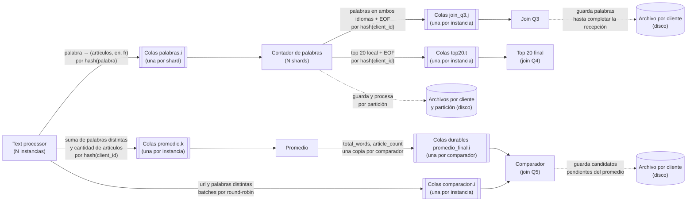

## Q3

1. Los Text processor consumen de la cola compartida `texto`. `WordsOutput` agrupa las palabras del batch con sus cantidades de artículos y marcas de idioma, y publica cada palabra en `palabras.<i>`, elegida por su hash.
2. Cada Contador de palabras guarda las entradas en archivos por cliente y partición. Cuando completa los EOF y los conteos de procesamiento y recepción de todos los Text processor, recorre las particiones de a uno y combina las marcas de idioma de cada palabra. Publica las palabras presentes en inglés y francés en `join_q3.<j>`, elegido por hash del cliente, y después manda su EOF con la cantidad de mensajes enviados.
3. **Join Q3 (con estado, repartido por cliente).** Guarda las palabras recibidas en un archivo por cliente y registra los EOF y conteos en memoria mediante `UpstreamTracker`. Cuando tiene el EOF de todos los contadores y recibió la cantidad de mensajes anunciada en `sent`, lee el archivo y publica batches de resultados de Q3 directamente en la cola de resultados del gateway del cliente. Luego manda un único EOF de Q3, incluso si no hubo palabras compartidas, borra el archivo y libera el estado del cliente.

Una palabra pertenece a Q3 si aparece en al menos un artículo en inglés y en al menos un artículo en francés del mismo cliente. El hash de la palabra lleva todas sus apariciones al mismo shard, que decide si está presente en ambos idiomas. La respuesta final es la unión de las palabras compartidas que publica cada contador.

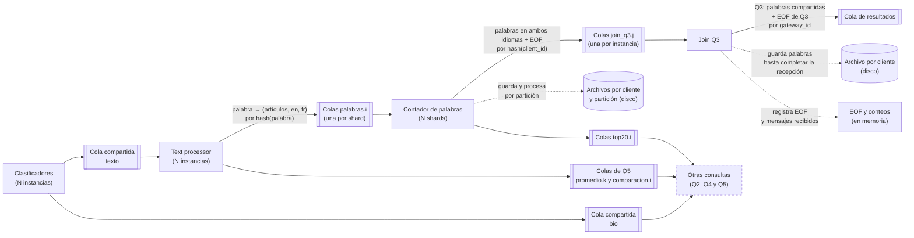

## Q4

1. Los Text processor consumen de la cola compartida `texto`. `WordsOutput` publica cada palabra en `palabras.<i>`, elegida por su hash, con la cantidad de artículos del batch en los que aparece. Cada palabra cuenta una sola vez por artículo.
2. Cada Contador de palabras guarda las entradas en archivos por cliente y partición. Cuando completa los EOF y los conteos de procesamiento y recepción de todos los Text processor, recorre las particiones de a uno, suma los artículos de cada palabra y mantiene su top local. Publica ese top en `top20.<t>`, elegido por hash del cliente, y después manda su EOF con la cantidad de mensajes enviados.
3. **Top 20 final (con estado, repartido por cliente).** Guarda los tops locales, los EOF y los conteos en memoria. Cuando tiene el EOF de todos los contadores y recibió los mensajes anunciados en `sent`, ordena las candidatas y publica hasta `TOP_SIZE` pares `(palabra, cantidad de artículos)` directamente en la cola de resultados del gateway del cliente. Luego manda un único EOF de Q4, incluso si no hubo palabras, y libera el estado del cliente.

El tamaño del top se configura con `TOP_SIZE`, que vale 20 por defecto, tanto en los contadores como en el nodo final.

El resultado es exacto porque cada palabra se cuenta completa en un solo shard. Con el mismo criterio de ordenamiento en todas las etapas, una palabra del top 20 global también está en el top 20 de su shard. Por eso alcanza con reunir los tops locales, como máximo N×20 candidatas con la configuración por defecto.

**Empates:** los contadores y el Top 20 final ordenan por cantidad de artículos de mayor a menor y, a igual cantidad, por palabra en orden alfabético. Ese criterio hace que el resultado sea determinista.

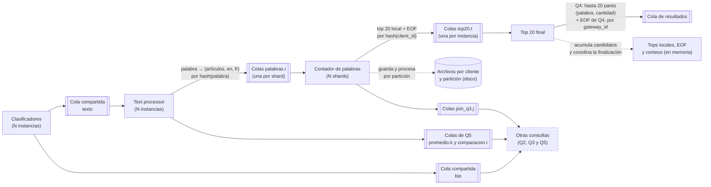

## Q5

Q5 devuelve `(url, cantidad de palabras distintas)` de los artículos creados desde 2021 cuyo abstract supera el promedio de los artículos creados hasta 2020 del mismo cliente. Ambas ramas usan las palabras limpias del Text processor y cuentan `len(set(words))`. El promedio reúne los idiomas de entrada. Los artículos sin fecha conocida se excluyen de Q5; un abstract histórico vacío aporta cero palabras y un artículo al denominador.

### Lado del promedio

1. `Q5Output` publica por batch la suma de palabras distintas de los artículos históricos y su cantidad de artículos. Envía esas estadísticas a `promedio.<k>`, elegido por hash del cliente.
2. **Promedio (con estado, repartido por cliente).** Average acumula `total_words` y `article_count`. Espera los EOF de todos los Text processor y verifica los conteos de procesamiento y recepción.
3. Cuando se completa la recepción, envía el par exacto `(total_words, article_count)` directamente a cada cola durable `promedio_final.<i>`, una por comparador. Cada comparador recibe su copia. Si no hubo artículos históricos, las estadísticas son `(0, 0)`.

### Lado de la comparación

1. Para los artículos desde 2021, `Q5Output` arma candidatos con url y cantidad de palabras distintas.
2. Reparte los batches por round-robin entre las colas `comparacion.<i>`. Cada comparador recibe una parte de los candidatos del cliente.

### Comparador (con estado, N instancias)

Cada instancia consume dos colas propias: `comparacion.<i>` para los candidatos y `promedio_final.<i>` para las estadísticas históricas finales.

1. Mientras espera las estadísticas de un cliente, guarda sus candidatos en un archivo por cliente. Hace ack de cada batch después de escribirlo.
2. Cuando llegan las estadísticas, recorre el archivo en bloques acotados por cantidad de candidatos y bytes, para seguir atendiendo RabbitMQ. Los candidatos nuevos se comparan directamente mientras se vacía el archivo anterior.
3. La comparación es exacta: `word_count * article_count > total_words`, siempre que `article_count > 0`. Sin artículos históricos, Q5 queda sin resultados. Si el promedio histórico es cero y hubo artículos, pasan los candidatos con conteo positivo.
4. Publica los resultados con url y conteo directamente en la cola de resultados del gateway del cliente, elegido por `gateway_id`. Hace ack de los candidatos nuevos después de publicar sus resultados, y del promedio después de recorrer correctamente el archivo pendiente.
5. Manda su EOF de Q5 cuando conoce las estadísticas finales, terminó de recorrer el archivo y completó los EOF y conteos de todos los Text processor. El EOF anuncia la cantidad de mensajes de resultados enviados por esa instancia.

El almacenamiento en disco limita la memoria dedicada a candidatos pendientes. El comparador mantiene en memoria las estadísticas y los conteos de los clientes activos, y procesa el archivo en pasos acotados. Borra el archivo al terminar de recorrerlo y libera el estado activo cuando completa al cliente.

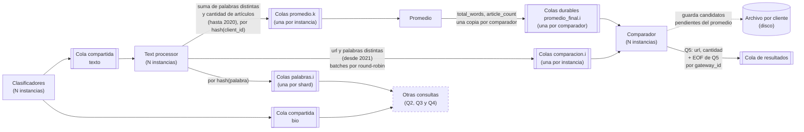

Los nodos coordinan el fin de cada cliente mediante EOF, LATE_EOF y conteos de mensajes. El gateway reúne los EOF de todos los comparadores y verifica que haya recibido los mensajes de resultados anunciados antes de dar por terminada Q5.

# Salida del sistema

El despliegue actual tiene un gateway único que conserva la conexión TCP y el estado de las cinco consultas de cada cliente. Los productores publican directamente en la cola de resultados del gateway indicado por `gateway_id`. El gateway identifica al cliente mediante `client_id` y responde por su conexión original.

1. **Cola de resultados.** La cola `resultados.<gateway_id>` recibe los resultados de las cinco consultas:

    | Nodo | Consulta | Qué publica |
    |---|---|---|
    | Clasificador | Q1 | url y date_modified |
    | Buscador de imágenes | Q2 | name, url y bytes de la imagen |
    | Join Q3 | Q3 | palabras compartidas |
    | Top 20 final | Q4 | hasta TOP_SIZE pares (palabra, cantidad de artículos), 20 por defecto |
    | Comparador | Q5 | url y cantidad de palabras distintas |

    Los resultados llevan `client_id`, `gateway_id`, número de consulta y filas. Los productores también publican EOF y, en las etapas que procesan batches tardíos, LATE_EOF con sus conteos.
2. **Entrega por cliente.** El consumidor de resultados del gateway busca la sesión de `client_id` y envía las filas por su socket como `RESULTS`. En el flujo exitoso hace ack después de enviarlas. Con prefetch 1, los resultados pendientes esperan en RabbitMQ cuando el cliente lee lento.
3. **Fin de cada consulta.** El gateway reúne los EOF de los orígenes esperados y comprueba los mensajes recibidos frente a los anunciados en `sent`. Q1 y Q2 también verifican los conteos de procesamiento frente al total. Q1 espera a todos los clasificadores; Q2, a todos los descargadores; Q3 y Q4, a un único nodo final por cliente; Q5, a todos los comparadores. Cuando una consulta se completa, envía `QUERY_DONE` con su número.
4. **Fin del cliente.** Cuando terminó la entrada y se completaron las cinco consultas, envía `ALL_DONE`. Después cierra la conexión TCP y libera la sesión del cliente.
5. **Archivos del cliente.** El cliente escribe los resultados progresivamente en `q1.jsonl` a `q5.jsonl`. Para Q2 guarda los bytes de cada imagen y su referencia en el archivo de resultados. Verifica los finales de las cinco consultas, `ALL_DONE` y el cierre de la conexión.

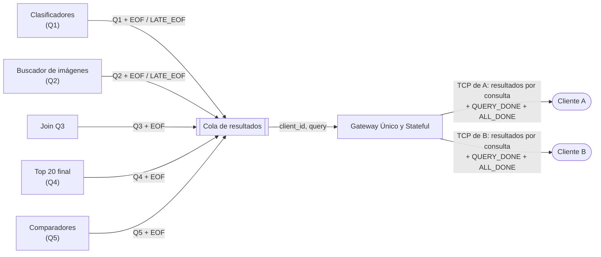

# Propagación de EOF

Cuando termina de enviar los artículos, el cliente manda `END_OF_DATA`. El gateway publica un único EOF en la cola compartida `clasificacion`, con la cantidad de batches enviados. La finalización se coordina mediante EOF, LATE_EOF y conteos de mensajes de cada etapa.

## Datos de los avisos

Cada EOF interno lleva `client_id`, `gateway_id`, `origin`, `processed`, `total` y `sent`. Los avisos de resultados también indican `query`.

| Campo | Qué representa |
|---|---|
| `origin` | Instancia que publica el aviso |
| `processed` | Batches de entrada procesados por esa instancia |
| `total` | Total esperado de entrada que anuncia el origen; las verificaciones globales se aplican en las etapas que comparten esa referencia |
| `sent` | Mensajes de salida enviados por ese origen al destino del aviso |

Las cantidades cuentan mensajes o batches, no artículos ni palabras. Un LATE_EOF lleva el origen y los incrementos de `processed` y `sent` correspondientes al trabajo procesado después del EOF inicial.

## Reglas

1. **Colas compartidas y control.** Los clasificadores comparten `clasificacion`; los filtros, `bio`; los descargadores, `imagenes`; y los Text processor, `texto`. La réplica que recibe un aviso de la etapa anterior lo reenvía por el exchange de control de su grupo. Cada réplica recibe una copia. Los clasificadores difunden el EOF del gateway; los otros tres grupos difunden EOF y LATE_EOF de sus orígenes anteriores.
2. **Origen y procesamiento.** `UpstreamTracker` registra cada EOF inicial una sola vez por origen y cliente. Cuando la etapa usa un total global, además espera que la suma de `processed` sea igual a `total`. Así, los EOF iniciales pueden llegar antes de que se haya procesado todo el trabajo anunciado.
3. **Recepción en colas por instancia.** Los contadores, Average y los comparadores también verifican que los mensajes recibidos coincidan con la suma de `sent`. Join Q3, Top 20 final y el gateway para Q3, Q4 y Q5 verifican orígenes y recepción; su referencia de recepción es la suma de `sent` de sus productores. El gateway para Q1 y Q2 verifica además el total global de procesamiento.
4. **Trabajo tardío.** Una réplica con cola compartida puede procesar un batch después de haber publicado su EOF. Después de publicar los datos de ese batch, manda LATE_EOF con los incrementos de procesamiento y salida. Los consumidores suman esas correcciones antes de completar sus condiciones de finalización. El descargador de imágenes difiere su EOF mientras tiene una descarga activa de ese cliente.
5. **Destinos de cada aviso.** Para una etapa con cola compartida se publica un aviso en esa cola y sus consumidores lo difunden por control. Los Text processor mandan avisos a todos los contadores y comparadores, incluidos los destinos con cero datos, y al Average elegido por hash del cliente. Los contadores mandan sus avisos al Join Q3 y al Top 20 final elegidos por hash del cliente. Average envía las estadísticas finales a la cola durable de cada comparador.
6. **Estado de coordinación.** Los orígenes y conteos se mantienen en memoria. Los archivos de los contadores, Join Q3 y comparadores guardan sus filas de datos. Cada etapa libera los datos al completar su trabajo; las etapas con cola compartida conservan temporalmente una marca del cliente para emitir correcciones por batches tardíos. Average y los comparadores guardan una marca de hasta 1024 clientes terminados para ignorar los mensajes que lleguen después.
7. **Fin de resultados.** El gateway mantiene un tracker por cliente y consulta. Envía `QUERY_DONE` cuando se completan los orígenes y conteos de esa consulta, y `ALL_DONE` cuando terminó la entrada y se completaron las cinco consultas.

## Orígenes esperados y salidas

El número de orígenes se combina con las condiciones de procesamiento y recepción descritas arriba.

| Nodo | Orígenes de EOF esperados | Qué publica al coordinar la finalización |
|---|---|---|
| Clasificador | 1 EOF del gateway, difundido por control | su EOF en `texto`, `bio` y resultados de Q1; emite LATE_EOF si procesa batches tardíos |
| Filter biography | todos los clasificadores, vía control | su EOF en `imagenes`, con correcciones por trabajo tardío |
| Buscador de imágenes | todos los filtros, vía control | su EOF de Q2 después de terminar su trabajo activo; puede emitir correcciones por batches tardíos |
| Text processor | todos los clasificadores, vía control | su EOF a todos los contadores y comparadores y al Average del cliente, con correcciones por trabajo tardío |
| Contador de palabras | todos los Text processor | palabras compartidas y top local, seguidos de EOF al Join Q3 y al Top 20 final del cliente |
| Join Q3 | todos los contadores | resultados de Q3 y un único EOF de Q3 |
| Top 20 final | todos los contadores | resultados de Q4 y un único EOF de Q4 |
| Promedio | todos los Text processor | estadísticas finales exactas en la cola durable de cada comparador |
| Comparador | todos los Text processor, más estadísticas finales y archivo pendiente recorrido | resultados y EOF de Q5 |
| Gateway | Q1: todos los clasificadores; Q2: todos los descargadores; Q3: 1; Q4: 1; Q5: todos los comparadores | QUERY_DONE por consulta y ALL_DONE al completar la entrada y las cinco consultas |

## Ejemplo

Con dos clasificadores, dos Text processor y un contador de palabras para el cliente A. Los participantes de clasificadores y Text processor representan las dos réplicas de cada etapa. Las publicaciones al contador viajan por `palabras.0`.

El ejemplo muestra un Text processor que publica su EOF antes de procesar un batch tardío. El contador ya tiene ambos orígenes, pero espera la corrección de `processed` y `sent` antes de emitir sus salidas.

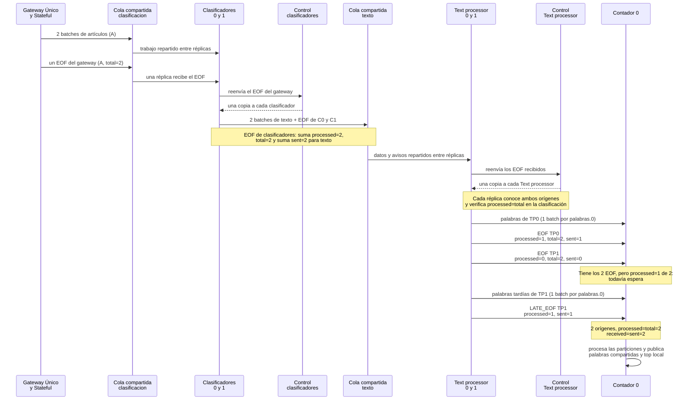
