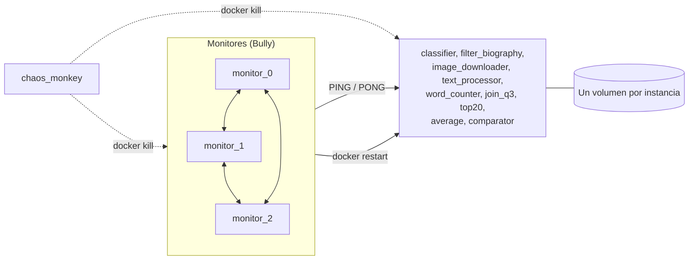

# Tolerancia a fallas: borrador de diseño

Tres **monitores** eligen un líder con **Bully**. El líder revisa a cada nodo con heartbeats y reinicia al que se cae. Cada nodo, al arrancar, **se reconstruye solo** desde lo que guardó en disco, y todo mensaje lleva un **id determinístico** para que reprocesar no duplique resultados.

## Qué pide el enunciado

| Requisito | Cómo lo cubrimos |
|---|---|
| Tolerar fallas abruptas de un proceso y caídas de otros nodos | Estado persistido, ids determinísticos y deduplicación (secciones 2 y 3) |
| Reiniciar procesos caídos, con Docker-in-Docker si hace falta | El monitor líder reinicia el contenedor por el socket de Docker (sección 1) |
| Verificar disponibilidad comunicándose con el nodo, sin usar Docker | Heartbeat PING/PONG propio de cada nodo (sección 1) |
| Algoritmo de consenso implementado por nosotros | Bully entre los monitores (sección 1) |
| Herramienta tipo Chaos Monkey | Contenedor que mata nodos al azar (sección 6) |

## Supuestos

- **El gateway no se cae.** Puede guardar en memoria todo lo que necesite por cliente.
- **RabbitMQ no se cae.** Las colas son durables y los mensajes persistentes.
- **El cliente no se cae.** Es externo al sistema.
- **El disco no se pierde.** Cada instancia guarda su estado en un volumen propio.
- **Las fallas son de tipo crash:** un proceso se muere o se cuelga, pero no manda mensajes incorrectos.

## Qué pasa hoy si se cae un nodo

| Problema | Dónde | Consecuencia |
|---|---|---|
| Nadie reinicia al nodo | No hay monitor ni `restart` | La consulta queda colgada |
| Una excepción en `on_message` sale de `start_consuming` | `middleware_rabbitmq.py` | Un mensaje que siempre falla mata al nodo en cada entrega |
| Contadores y trackers en memoria | `processed`, `sent`, `_finished`, `UpstreamTracker` | Al reiniciar, los EOF salen con números incorrectos |
| `Average`, `Top20` y el promedio del `Comparator` en memoria | `average.py`, `top20.py`, `comparator.py` | Se pierde lo acumulado |
| El control usa una cola temporal exclusiva | `queue_declare(queue="", exclusive=True)` | Una réplica caída pierde el EOF reenviado |
| Reprocesar publica dos veces | Se publica antes del `ack` | `received` supera a `sent` y la etapa siguiente no cierra |
| `LATE_EOF` no se deduplica | `UpstreamTracker.add_late_eof` | Un `LATE_EOF` repetido rompe las cuentas |
| El reparto a comparadores usa un contador en memoria | `Q5Output._next_comparator` | Un reproceso en otra réplica manda el duplicado a otro comparador |
| El gateway reenvía todo lo que recibe | `gateway/results.py` | Un resultado duplicado le llega dos veces al cliente |

Lo que ya ayuda: los nodos hacen `ack` después de publicar, así que un mensaje en vuelo vuelve a la cola si el nodo se cae.

## Vista general

El gateway, RabbitMQ y los clientes no se vigilan, porque según los supuestos no se caen.

## 1. Monitores

### Heartbeat

- **Cada nodo responde PING en un hilo propio,** separado del que consume la cola. Si no, una descarga larga de Q2 o un `_finish_client` pesado parecerían una caída.
- **Formato:** UDP al puerto 9000, con un número de secuencia. El nodo responde `PONG <secuencia> <estado>`, con estado `ok` o `recuperando`. Se usa UDP porque un PING perdido se trata igual que uno sin respuesta.
- **Detección:** el líder manda un PING por segundo a cada nodo. Si no responde 3 veces seguidas, lo da por caído.
- **Nodo colgado:** si el proceso vive pero no responde, cuenta como caído y el reinicio lo mata.
- **Período de gracia:** tras reiniciar un nodo, el líder espera 10 segundos antes de volver a juzgarlo. El nodo levanta el hilo de PONG antes de recuperar su estado y responde `recuperando` mientras tanto, así una recuperación larga no se toma como caída.

Docker se usa solo para reiniciar, nunca para saber si un nodo está vivo.

### Reinicio

- **Solo el líder reinicia,** con `docker restart <container_name>` por el socket de Docker montado. Los nombres son fijos y salen de `nodes.env`.
- **El nodo vuelve con el mismo nombre y el mismo volumen,** así que recupera su id y su estado.
- **Sin bibliotecas nuevas:** se llama al CLI de Docker o se habla HTTP con el socket, porque cada biblioteca necesita aprobación del docente.
- **Reiniciar dos veces no hace daño:** si por un momento hay dos líderes, el nodo solo se recupera dos veces.

### Bully

Los monitores se vigilan entre sí, así que un monitor caído también se reinicia.

1. **Cada monitor tiene un id fijo.** El líder es el monitor vivo con el id más alto.
2. **El líder manda heartbeats** a los demás monitores.
3. **Si un seguidor deja de recibirlos,** manda `ELECTION` a los monitores con id mayor.
4. **Si alguno responde `ANSWER`,** ese sigue la elección y el que preguntó espera.
5. **Si nadie responde,** el que preguntó se declara líder y manda `COORDINATOR` a todos.
6. **El nuevo líder reinicia al monitor caído.** Si ese tenía el id más alto, al volver arranca una elección y recupera el liderazgo.

## 2. Que cada nodo se recupere solo

### Ids determinísticos

Cada mensaje lleva un `msg_id` que **se deriva del mensaje de entrada, no de la réplica que lo procesa**. Si `classifier_0` se cae y el batch lo reprocesa `classifier_3`, este publica los mismos ids y el receptor descarta los repetidos.

| Quién | Entrada | Ids que publica |
|---|---|---|
| Gateway | Batch número `n` del cliente | `b<n>` |
| Clasificador | `b<n>` | `b<n>:t` a `texto`, `b<n>:b` a `bio`, `b<n>:q1` a resultados |
| Filter biography | `b<n>:b` | `b<n>:b:<parte>` a `imagenes` |
| Buscador de imágenes | `b<n>:b:<parte>` | `b<n>:b:<parte>:<imagen>` a resultados |
| Text processor | `b<n>:t` | `b<n>:t:w<shard>.<parte>`, `b<n>:t:a`, `b<n>:t:c<parte>` |
| Contador de palabras | Fin del cliente | `wc<id>:s<parte>` a Join Q3, `wc<id>:top` a Top 20 |
| Join Q3, Top 20, Average | Fin del cliente | `q3:<parte>`, `q4`, `avg` |
| Comparador | `b<n>:t:c<parte>` | `b<n>:t:c<parte>:r<parte>` a resultados |

Para que funcione, todo reparto tiene que ser determinístico:

- **El comparador se elige con `hash(msg_id) % N`** en lugar de un round-robin con contador.
- **El comparador procesa cada mensaje de candidatos como una unidad** y publica `<id>:r<parte>`, llegue antes o después del promedio.
- **Las partes tienen que ser estables:** con la misma entrada, `chunk_rows` y `BatchBuilder` tienen que armar las mismas partes.

### Orden por mensaje

1. Procesar el mensaje.
2. Publicar las salidas con sus ids.
3. Guardar en disco el estado y el id procesado, con `fsync`.
4. Hacer `ack`.

| Se cae entre | Al volver | Por qué no se rompe |
|---|---|---|
| 1 y 2 | Se reprocesa | No salió nada |
| 2 y 3 | Se reprocesa y se republica | Los ids son los mismos y el receptor los descarta |
| 3 y 4 | El id ya está guardado | Se reconoce como visto y solo se hace `ack` |

El mensaje que vuelve puede tomarlo otra réplica. Los ids lo cubren, pero cambia cómo se cuentan los EOF (sección 3).

### Almacenamiento

- **Un volumen con nombre por instancia.** `docker restart` conserva el contenedor, y el volumen protege también si se recrea.
- **Estado chico** (contadores, ids, promedios, tops): un snapshot que se escribe en un archivo temporal y se renombra encima del anterior, así nunca queda a medias.
- **Datos grandes** (`word_counter`, `join_q3`, `comparator`): archivos por cliente con `append`, cada registro con su `msg_id`. Al leer se ignoran ids repetidos y una última línea cortada.
- **Un `fsync` antes de cada `ack`:** con `prefetch=1` cada réplica tiene un solo mensaje en vuelo, así que no hay mensajes para agrupar sin demorar el `ack`.

### Qué guarda y cómo deduplica cada nodo

| Nodo | Qué guarda | Cómo descarta repetidos |
|---|---|---|
| classifier | Ids procesados y enviados, clientes terminados | Id ya visto |
| filter_biography | Lo mismo | Id ya visto |
| image_downloader | Lo mismo. La caché ya está en disco | Id ya visto |
| text_processor | Lo mismo, por destino | Id ya visto |
| word_counter | Tracker. Filas con su id en los archivos | Ids repetidos al leer |
| join_q3 | Tracker. Palabras con su id en el archivo | Ids repetidos. Las palabras son un conjunto |
| top20 | Candidatas y tracker | Id ya visto |
| average | Suma, cantidad, ids sumados y tracker | Solo suma ids nuevos |
| comparator | Promedio, tracker y candidatos pendientes con su id | Id ya visto. El promedio se acepta una vez |

## 3. El EOF con caídas

### Colas de control durables

La cola temporal exclusiva de control pasa a ser una **cola durable con nombre por réplica**, por ejemplo `control_clasificador.3`. Si la réplica está caída, la copia del EOF la espera ahí.

### De contar mensajes a contar ids

Con caídas, las cuentas actuales fallan:

1. `classifier_0` procesa `b7`, publica, guarda `processed=1` y se cae antes del `ack`.
2. `b7` vuelve a la cola, lo toma `classifier_3` y también cuenta `processed=1`.
3. La suma da un batch de más: `processed` supera a `total` y la etapa siguiente no cierra.

Por eso **el EOF lleva conjuntos de ids en lugar de cantidades**:

| Hoy | Propuesta |
|---|---|
| `processed`: cuántos batches procesó | Ids de entrada que procesó |
| `total`: cuántos había | Ids de entrada esperados, anunciados por la etapa anterior |
| `sent`: cuántos mensajes mandó a este destino | Ids que mandó a este destino |

Una etapa termina cuando tiene el EOF de todos los orígenes, la unión de los ids procesados cubre los esperados, y recibió todos los ids anunciados. La cadena empieza en el gateway, que anuncia `b0` a `b<N-1>`.

Como son uniones, recibir algo dos veces no cambia nada, y el `LATE_EOF` se vuelve idempotente.

### Formato de los conjuntos de ids

Un cliente con el dataset completo y batches de 100 filas tiene unos 100.000 batches, así que el formato importa.

| Formato | A favor | En contra |
|---|---|---|
| **Lista de ids** | Lo más simple. Sirve para cualquier id, incluidos los compuestos como `b7:t:w2.0` | Crece con cada mensaje: con 100.000 batches, cerca de 1 MB por EOF |
| **Rangos** (`[[0, 99], [150, 300]]`) | Muy chico cuando los ids son consecutivos | Con cola compartida, RabbitMQ reparte los batches salteados entre réplicas y salen muchos rangos cortos. No sirve para ids compuestos |
| **Mapa de bits por número de batch** | Tamaño fijo (100.000 batches son unos 12,5 KB) y la unión es un OR | Solo sirve para ids numerados de forma densa. Para los ids compuestos hay que mandar además cuántas partes salieron de cada batch |

### Clientes terminados

`_finished` se guarda en el snapshot con los últimos 1024 clientes terminados, como ya hacen `Average` y `Comparator`. No se borra a los pocos mensajes, porque con reinicios el trabajo tardío puede llegar más tarde que hoy.

## 4. El gateway

Aunque no se cae, tiene que cambiar:

- **Asigna el id de cada batch** (`b0`, `b1`, ...) y lo anuncia en el EOF de entrada.
- **Descarta resultados repetidos** antes de mandarlos al cliente, guardando los ids vistos por sesión.
- **Cierra cada consulta con conjuntos de ids,** igual que las demás etapas.

## 5. Mensajes que siempre fallan

Hoy una excepción mata al nodo, el mensaje vuelve y lo vuelve a matar. Con reinicio automático, sería un ciclo infinito.

- **Capturar el error** en el callback y contar los intentos de ese id. El contador se guarda en disco antes de procesar, para que no vuelva a cero si el error mata al nodo.
- **Al tercer intento fallido,** mandarlo a una cola de descartados y hacer `ack`.
- **El id descartado cuenta como procesado** en el EOF, o la etapa no cierra.

## 6. Chaos Monkey

Un contenedor que, cada cierto tiempo, mata un nodo al azar con `docker kill`. Usar Docker para **provocar** caídas está permitido: la restricción es para **verificar** disponibilidad.

- **Por defecto,** mata un nodo cada 30 segundos. El intervalo, los nodos permitidos y las caídas simultáneas se configuran.
- **También mata monitores,** incluido el líder, para mostrar la elección.
- **Nunca toca** al gateway, a RabbitMQ ni a los clientes.
- **Registra** qué mató y cuándo, para la demo.
